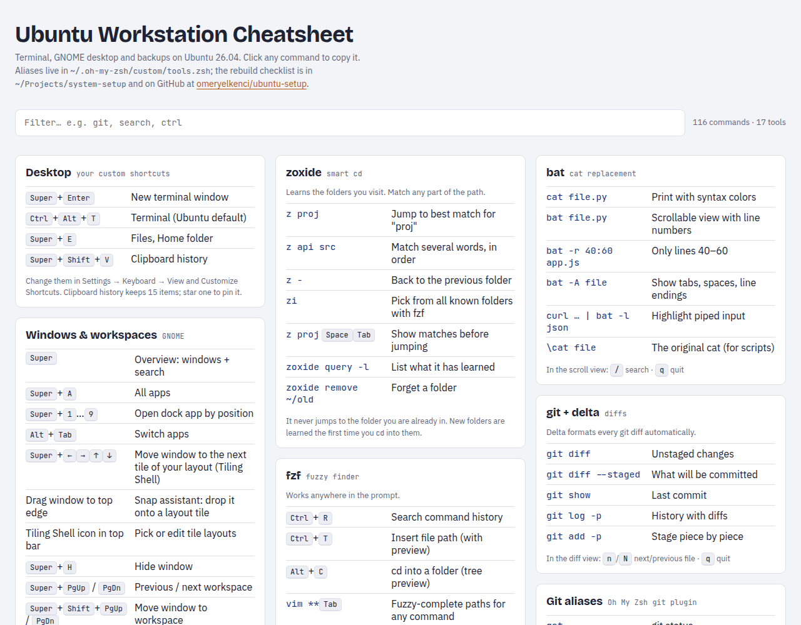

# New System Setup (Ubuntu + GNOME)

Checklist to rebuild my terminal and desktop setup on a fresh Ubuntu install.
Made on Ubuntu 26.04 / GNOME 50. Run the steps in order, from inside this folder
(`cd system-setup`), so the `configs/` paths resolve.

**Repo:** https://github.com/omeryelkenci/ubuntu-setup

The included [`cheatsheet.html`](cheatsheet.html) is a searchable, click-to-copy reference
for everything this setup installs. Open it in any browser:

<picture>
  <source media="(prefers-color-scheme: dark)" srcset="docs/cheatsheet-dark.png">
  
</picture>

Backed-up config files in `configs/`:
- `tools.zsh` — aliases and settings for zoxide, eza, bat, fd, fzf, lazygit
- `p10k.zsh` — my Powerlevel10k prompt style (from `p10k configure`)
- `timeshift.json` — Timeshift schedule and excludes (disk and username filled in at setup)

On a new machine, get this folder first:
```bash
sudo apt install -y git
git clone https://github.com/omeryelkenci/ubuntu-setup.git ~/Projects/system-setup
cd ~/Projects/system-setup
```

## Contents

1. [Terminal](#1-terminal): zsh, Oh My Zsh, plugins, terminal tools, delta, Nord colors
2. [Desktop (GNOME)](#2-desktop-gnome): shortcuts, extensions, quick settings
3. [System snapshots (Timeshift)](#3-system-snapshots-timeshift): install, configure, first snapshot
4. [Home folder backups](#4-home-folder-backups-backups-app--google-drive): Déjà Dup to Google Drive, restoring
5. [Before reinstalling](#5-before-reinstalling-refresh-the-backups): refresh the config backups

---

## 1. Terminal

- [ ] **Install packages**
  ```bash
  sudo apt install -y zsh git curl fzf zoxide eza bat ripgrep fd-find tealdeer git-delta lazygit btop
  ```

- [ ] **Install Oh My Zsh** (without switching shell yet)
  ```bash
  RUNZSH=no CHSH=no sh -c "$(curl -fsSL https://raw.githubusercontent.com/ohmyzsh/ohmyzsh/master/tools/install.sh)"
  ```

- [ ] **Make zsh the default shell**, then log out and back in later
  ```bash
  sudo chsh -s /usr/bin/zsh $USER
  ```

- [ ] **Add plugins and the Powerlevel10k theme**
  ```bash
  C=${ZSH_CUSTOM:-$HOME/.oh-my-zsh/custom}
  git clone --depth 1 https://github.com/zsh-users/zsh-autosuggestions $C/plugins/zsh-autosuggestions
  git clone --depth 1 https://github.com/zsh-users/zsh-syntax-highlighting $C/plugins/zsh-syntax-highlighting
  git clone --depth 1 https://github.com/romkatv/powerlevel10k.git $C/themes/powerlevel10k
  ```

- [ ] **Edit `~/.zshrc`**
  ```bash
  sed -i 's/^plugins=(git)$/plugins=(git fzf zsh-autosuggestions zsh-syntax-highlighting)/' ~/.zshrc
  sed -i 's|^ZSH_THEME=.*|ZSH_THEME="af-magic"|' ~/.zshrc
  sed -i '/^ZSH_THEME=/a [[ -n $TRY_THEME ]] \&\& ZSH_THEME=$TRY_THEME  # used by the try-theme command' ~/.zshrc
  ```
  Expected result:
  ```
  ZSH_THEME="af-magic"
  [[ -n $TRY_THEME ]] && ZSH_THEME=$TRY_THEME  # used by the try-theme command
  plugins=(git fzf zsh-autosuggestions zsh-syntax-highlighting)
  ```
  The second line makes `try-theme <name>` work (preview a theme in a temporary shell).

- [ ] **Restore config files**
  ```bash
  cp configs/tools.zsh ~/.oh-my-zsh/custom/tools.zsh
  ```

- [ ] **Optional: Powerlevel10k instead of af-magic** (my previous theme; its clone step is above)
  ```bash
  sed -i 's|^ZSH_THEME=.*|ZSH_THEME="powerlevel10k/powerlevel10k"|' ~/.zshrc
  cp configs/p10k.zsh ~/.p10k.zsh
  echo '[[ ! -f ~/.p10k.zsh ]] || source ~/.p10k.zsh' >> ~/.zshrc
  ```
  Or run `p10k configure` to choose a new style.

- [ ] **Use delta for git diffs**
  ```bash
  git config --global core.pager delta
  git config --global interactive.diffFilter 'delta --color-only'
  git config --global delta.navigate true
  git config --global merge.conflictStyle zdiff3
  ```

- [ ] **Download tldr pages**
  ```bash
  tldr --update
  ```

- [ ] **Optional: Nerd Font for prompt icons** (MesloLGS NF)
  ```bash
  mkdir -p ~/.local/share/fonts && cd ~/.local/share/fonts
  for s in Regular Bold Italic "Bold%20Italic"; do
    curl -fsSL -o "MesloLGS NF ${s//%20/ }.ttf" "https://github.com/romkatv/powerlevel10k-media/raw/master/MesloLGS%20NF%20$s.ttf"
  done
  fc-cache -f && cd -
  ```
  Then pick "MesloLGS NF" as the terminal font. For Ptyxis:
  ```bash
  gsettings set org.gnome.Ptyxis use-system-font false
  gsettings set org.gnome.Ptyxis font-name 'MesloLGS NF 11'
  ```
  (I currently use the system font, so this is off on my machine.)

- [ ] **Terminal colors: Nord palette** (Ptyxis, default profile)
  ```bash
  U=$(gsettings get org.gnome.Ptyxis default-profile-uuid | tr -d "'")
  gsettings set org.gnome.Ptyxis.Profile:/org/gnome/Ptyxis/Profiles/$U/ palette 'nord'
  ```

- [ ] **Log out and back in.** Open a terminal and check: grey suggestions as you type,
  `Ctrl+R` opens fzf, `ll` shows the eza list.

---

## 2. Desktop (GNOME)

- [ ] **Keyboard shortcuts**: Super+Enter = terminal, Super+E = Home folder
  ```bash
  P=/org/gnome/settings-daemon/plugins/media-keys/custom-keybindings/custom0/
  S=org.gnome.settings-daemon.plugins.media-keys.custom-keybinding:$P
  gsettings set $S name 'Terminal'
  gsettings set $S command 'ptyxis --new-window'
  gsettings set $S binding '<Super>Return'
  gsettings set org.gnome.settings-daemon.plugins.media-keys custom-keybindings "['$P']"
  gsettings set org.gnome.settings-daemon.plugins.media-keys home "['<Super>e']"
  ```

- [ ] **Install Extension Manager** (app for browsing GNOME extensions)
  ```bash
  sudo apt install -y gnome-shell-extension-manager
  ```

- [ ] **Install extensions** — each shows a confirmation dialog; click Install
  ```bash
  for u in clipboard-indicator@tudmotu.com caffeine@patapon.info Vitals@CoreCoding.com tilingshell@ferrarodomenico.com; do
    gdbus call --session --dest org.gnome.Shell.Extensions --object-path /org/gnome/Shell/Extensions \
      --method org.gnome.Shell.Extensions.InstallRemoteExtension $u
  done
  ```
  | Extension | What it does |
  |---|---|
  | Clipboard Indicator | Clipboard history |
  | Caffeine | Keep the screen awake (toggle in the top-right system menu) |
  | Vitals | CPU, memory, temperature in the top bar |
  | Tiling Shell | Tile layouts; Super+arrows move between tiles |

  Or search for each one in Extension Manager → Browse.

- [ ] **Clipboard history on Super+Shift+V** (default is Ctrl+F9)
  ```bash
  gsettings --schemadir ~/.local/share/gnome-shell/extensions/clipboard-indicator@tudmotu.com/schemas \
    set org.gnome.shell.extensions.clipboard-indicator toggle-menu "['<Super><Shift>v']"
  ```

- [ ] **Always show the Caffeine icon in the top bar** (default: only while it's on)
  ```bash
  gsettings --schemadir ~/.local/share/gnome-shell/extensions/caffeine@patapon.info/schemas \
    set org.gnome.shell.extensions.caffeine show-indicator 'always'
  ```

- [ ] **Turn off Ubuntu's Tiling Assistant** (conflicts with Tiling Shell)
  ```bash
  gnome-extensions disable tiling-assistant@ubuntu.com
  ```

- [ ] **Vitals**: click the star next to the readings you want in the top bar.

- [ ] **Quick settings**: dock click minimizes, faster key repeat, battery %, Night Light, Caps Lock = Ctrl
  ```bash
  gsettings set org.gnome.shell.extensions.dash-to-dock click-action 'minimize-or-previews'
  gsettings set org.gnome.mutter center-new-windows true
  gsettings set org.gnome.desktop.peripherals.keyboard delay 250
  gsettings set org.gnome.desktop.peripherals.keyboard repeat-interval 20
  gsettings set org.gnome.desktop.interface show-battery-percentage true
  gsettings set org.gnome.settings-daemon.plugins.color night-light-enabled true
  gsettings set org.gnome.settings-daemon.plugins.color night-light-schedule-automatic true
  gsettings set org.gnome.desktop.input-sources xkb-options "['ctrl:nocaps']"
  ```

---

## 3. System snapshots (Timeshift)

- [ ] **Install**
  ```bash
  sudo apt install -y timeshift
  ```

- [ ] **Configure**: RSYNC, daily 5 / weekly 3 / boot 3, home folders excluded.
  `configs/timeshift.json` has these settings with placeholders for the disk and username;
  this fills them in for the current machine and installs it:
  ```bash
  sed -e "s/REPLACE_WITH_DISK_UUID/$(findmnt -no UUID /)/" -e "s/REPLACE_WITH_USERNAME/$USER/" \
    configs/timeshift.json | sudo tee /etc/timeshift/timeshift.json >/dev/null
  ```
  (Or open the Timeshift app and pick the same options in its wizard.)

- [ ] **First snapshot** (also installs the schedule's cron jobs)
  ```bash
  sudo timeshift --create --comments "First snapshot after setup"
  sudo timeshift --list
  ```

Timeshift protects the system, not personal files, and snapshots live on the same disk.
Personal files are backed up separately, see below.

---

## 4. Home folder backups (Backups app → Google Drive)

- [ ] **Restore my files first** (on a new install): open Backups → **Restore**, sign in to
  Google, enter the encryption password (kept in my password manager), pick the latest backup.

- [ ] **Install and configure for future backups**
  ```bash
  sudo apt install -y deja-dup
  gsettings set org.gnome.DejaDup backend 'google'
  gsettings set org.gnome.DejaDup exclude-list "['\$TRASH', '\$DOWNLOAD', '$HOME/.cache']"
  gsettings set org.gnome.DejaDup periodic true
  gsettings set org.gnome.DejaDup periodic-period 1
  gsettings set org.gnome.DejaDup.Google folder 'Backups/ubuntu-personal-laptop'
  ```
  Then open Backups → **Back Up Now** → sign in to Google → set the encryption password.
  Backups go to `My Drive/Backups/ubuntu-personal-laptop`.
  To restore on a new machine, set that same folder first, then use Restore.
  Déjà Dup can only see Drive folders it created itself: don't create, move or rename
  its folders in the Drive web UI. To change the location, change the setting above and
  let it make a fresh backup, then delete the old folder.
  Downloads, Trash and `~/.cache` are not backed up.

---

## 5. Before reinstalling: refresh the backups

If I change my prompt or aliases, copy the latest versions here first:
```bash
cp ~/.oh-my-zsh/custom/tools.zsh configs/tools.zsh
cp ~/.p10k.zsh configs/p10k.zsh
git add -A && git commit -m "Update configs" && git push
```

Cheatsheet for daily use: open `cheatsheet.html` in a browser.
